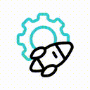
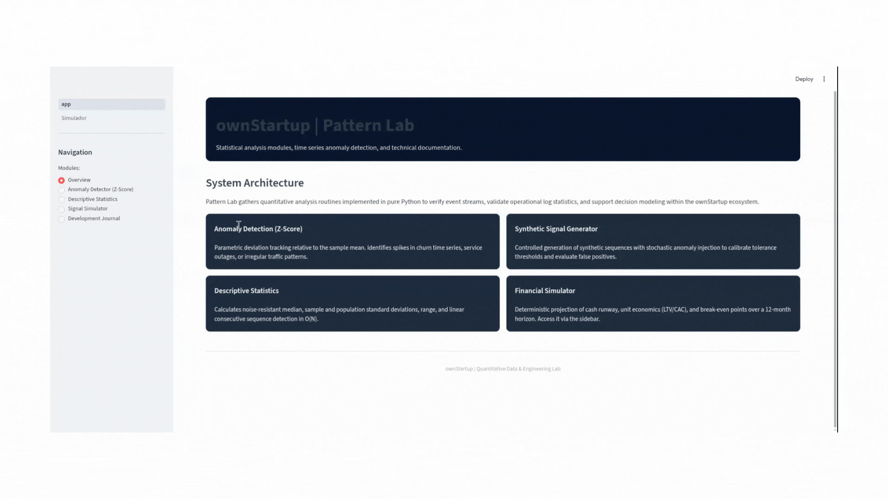
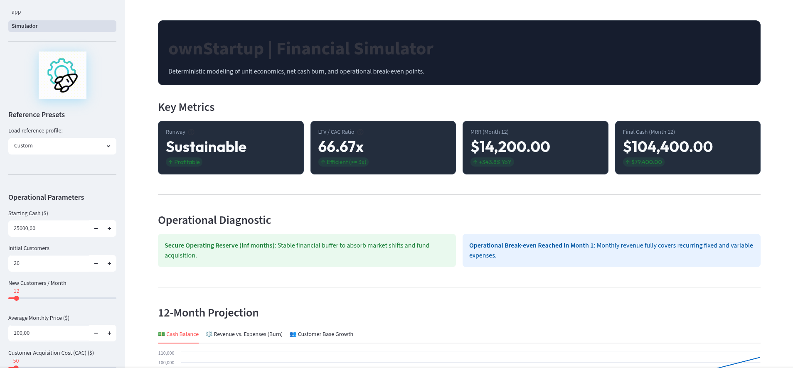
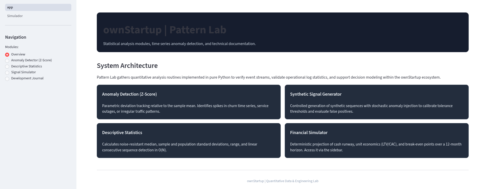

#  ownStartup

A financial unit economics simulator and quantitative analysis testbed built with pure Python and Streamlit.

## Preview



## Overview

**ownStartup** provides deterministic financial modeling for early-stage software companies and quantitative algorithms for signal verification:

1. **Financial Simulator**: Models recurring revenue, customer churn, fixed and variable expenses, unit economics (LTV/CAC), operational runway, and 12-month cash flow trajectories with automated break-even and insolvency detection.
2. **Pattern Lab**: A statistical testbed featuring Z-score anomaly detection, noise-resistant descriptive metrics, stochastic signal generation, and linear-time sequence analysis.

---

## Core Capabilities

### 1. Financial Simulator (`engine.py` / `pages/1_Simulador.py`)



- **Unit Economics**: Computes Lifetime Value (LTV), Customer Acquisition Cost (CAC), and LTV/CAC efficiency ratios based on ticket pricing, gross margin, and churn rate.
- **Runway & Burn Modeling**: Calculates monthly gross burn, net burn, and operational runway based on available capital reserves.
- **12-Month Projections**: Generates month-by-month cash balances, cohort customer counts, net burn, and identifies milestone events (operational break-even month and cash depletion month).

### 2. Pattern Lab (`app.py`)



- **Anomaly Detection (Z-Score)**: Filters outliers in event streams and metric spikes based on configurable standard deviation thresholds (mean ± k * std).
- **Descriptive Statistics**: Calculates median, sample and population standard deviation, variance, and linear contiguous sequence detection in O(N).
- **Synthetic Signal Generator**: Generates synthetic time series with stochastic noise and injected anomalies for calibration and threshold testing.

---

## Running Locally

1. **Clone the repository and enter the project folder**:
   ```bash
   git clone https://github.com/EngThi/ownStartup.git
   cd ownStartup/mini-challenges
   ```

2. **Install dependencies**:
   ```bash
   pip install -r requirements.txt
   ```

3. **Start the application**:
   ```bash
   streamlit run app.py
   ```

---

## Live Deployment

- **Production (Self-Hosted on Hack Club Nest VM)**: [ownstartup.chefthi.hackclub.app](https://ownstartup.chefthi.hackclub.app)
- **Alternative Mirror**: [ownstartup.streamlit.app](https://ownstartup.streamlit.app)

---

## Attribution

- Animated rocket icon created by [Magnific - Flaticon](https://www.flaticon.com/free-animated-icons/business-development).
